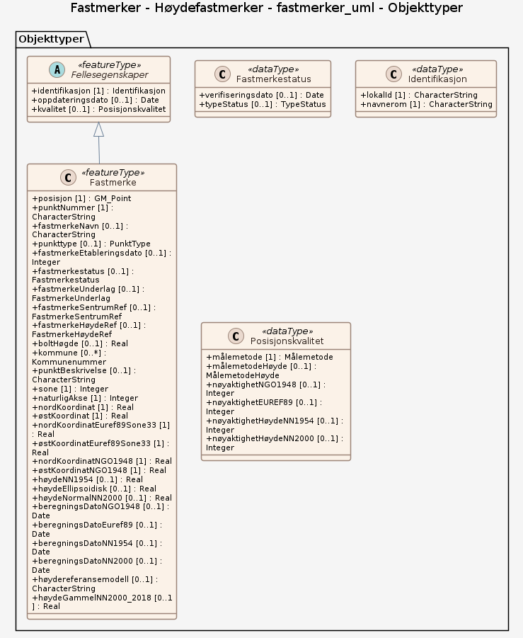

# Produktspesifikasjon: Fastmerker - Høydefastmerker

*Datasettet Fastmerker deles inn i tre grupper: Stam- og landsnettpunkter er bestemt med GNSS og er de mest nøyaktige fastmerkene. Ligger som oftest i rimelig avstand fra vei. Trekantpunkter er bestemt ved eldre vinkel- og avstandsmålinger og er derfor mindre nøyaktige. De anbefales ikke der det er høye krav til nøyaktighet. Trekantpunkter finnes også i områder langt fra vei. Mange av trekantpunktene i lavlandet er uegnet for GNSS-måling. Høydefastmerkene er meget godt bestemt i høyde ved presisjonsnivellement, men grunnrisskoordinatene er i mange tilfeller svært upresise. Mange høydefastmerker nær vei er dessverre gått tapt.*

**Nøkkelord:** fastmerke, Høydefastmerker, Trigpunkter, Nivellementsfastmerker, Geodesi, nivellementspunkt, Norge digitalt, modellbaserteVegprosjekter, fellesDatakatalog, Basis geodata, Fastmerkestatus, punktNummer, fastmerkeNavn, punkttype, fastmerkeEtableringsdato, fastmerkeUnderlag, fastmerkeSentrumRef, fastmerkeHøydeRef, boltHøgde, punktBeskrivelse, naturligAkse, nordKoordinat, østKoordinat, nordKoordinatEuref89Sone33, østKoordinatEuref89Sone33, nordKoordinatNGO1948, østKoordinatNGO1948, høydeNN1954, høydeEllipsoidisk, høydeNormalNN2000, beregningsDatoNGO1948, beregningsDatoEuref89, beregningsDatoNN1954, beregningsDatoNN2000, nøyaktighetNGO1948, nøyaktighetEUREF89, nøyaktighetHøydeNN1954, nøyaktighetHøydeNN2000

**Emnekategorier:** Stedsangivelse

**Geografisk utstrekning**:

- **Vest**: 4.5
- **Øst**: 32.799
- **Sør**: 57.7187
- **Nord**: 70.9183

**Geografisk område**:
Norge

**Tidsmessig utstrekning**:

- **Tidsperiode**:
  - **Fra**: 2026-10-15
  - **Til**: 2026-10-15

## Om spesifikasjonen

> **Denne versjonen av produktspesifikasjonen:**  
> **Opprettet dato:**  
> **Endret dato:** 2026-10-15 
> **Språk:** nor 
> **Kontaktinformasjon:** Kartverket, [kundesenter@kartverket.no](mailto:kundesenter@kartverket.no)

## Om produktet Fastmerker - Høydefastmerker

> **Romlig representasjonstype:** Vektor 
> **Unik identifikator:** <https://data.geonorge.no/sosi/hoydedata/fastmerker_hoydefastmerker> 
> **Kontaktinformasjon:** Kartverket, [kundesenter@kartverket.no](mailto:kundesenter@kartverket.no)
>
> **Romlig oppløsning:**
>
>
>
> **Begrensninger:**
>
> **Ressursbegrensninger**:
>
> - **Bruksbegrensninger**: Ingen begrensninger på bruk er oppgitt.
>
> **Juridiske begrensninger**:
>
> - **Tilgangsbegrensninger**: Åpne data
> - **Bruksbegrensninger**: Lisens
> - **Lisens**: No conditions apply to access and use
> - **Lisenslenke**: <http://inspire.ec.europa.eu/metadata-codelist/ConditionsApplyingToAccessAndUse/noConditionsApply>
> - **Andre begrensninger**: Ingen begrensninger oppgitt.
>
> **Sikkerhetsbegrensninger**:
>
> - **Klassifisering**: Ugradert

### Formål

Grunnlag for oppmåling og kartlegging.

### Bruksområde

Høydefastmerker: Høydegrunnlag der det er spesielt strenge krav til høydenøyaktighet.

## Omfang

### Hele datasettet

**Nivå**: dataset

**Nivåbeskrivelse**: Gjelder hele datasettet. Hvis omfang ikke er oppgitt under en overskrift, gjelder teksten for hele datasettet og alle leveranser

### fastmerker_uml

**Nivå**: dataset

## Datainnhold og struktur

### Datamodell - fastmerker_uml

➡️ [Se full datamodell for omfang "fastmerker_uml" (diagram per pakke og objektkatalog)](fastmerker-uml/objektkatalog.html)

## Referansesystem

| EPSG-kode | Navn på referansesystem |
| --- | --- |
| [EPSG:3035](https://epsg.io/3035) | [EUREF89 / ETRS89-LAEA Europe](https://register.geonorge.no/epsg-koder) |
| [EPSG:4258](https://epsg.io/4258) | [EUREF 89 Geografisk (ETRS 89) 2d](https://register.geonorge.no/epsg-koder) |
| [EPSG:5972](https://epsg.io/5972) | [EUREF89 UTM sone 32, 2d + NN2000](https://register.geonorge.no/epsg-koder) |
| [EPSG:5973](https://epsg.io/5973) | [EUREF89 UTM sone 33, 2d + NN2000](https://register.geonorge.no/epsg-koder) |
| [EPSG:5975](https://epsg.io/5975) | [EUREF89 UTM sone 35, 2d + NN2000](https://register.geonorge.no/epsg-koder) |

## Datakvalitet

**Nivå**: dataset

**Kvalitetsmål**: SOSI produktspesifikasjon: Fastmerker

- **Beskrivende resultat**: Dataene er ikke vurdert iht produktspesifikasjonen

**Kvalitetsmål**: Sosi applikasjonsskjema

- **Beskrivende resultat**: SOSI-filer er ikke vurdert i henhold til applikasjonsskjema

**Kvalitetsmål**: Sosi applikasjonsskjema

- **Beskrivende resultat**: GML-filer er ikke vurdert i henhold til applikasjonsskjema

## Datafangst og produksjon

Ingen prosseshistorie tilgjenglig.

## Vedlikehold

**Vedlikeholdsfrekvens**: Årlig

## Leveranse

| Tjeneste | Endepunkt | Type | Format | Leveranseenheter |
| --- | --- | --- | --- | --- |
| Geonorge nedlastning | [Lenke](https://nedlasting.geonorge.no/api/capabilities/43838cda-fa62-11e6-bc64-92361f002671) | GEONORGE:DOWNLOAD | FGDB, GML, PostGIS, SOSI | fylkesvis, kommunevis, landsfiler |
| Atom Feed | [Lenke](http://nedlasting.geonorge.no/geonorge/ATOM-feeds/Fasthoyde_AtomFeedFGDB.xml) | W3C:AtomFeed | FGDB | fylkesvis, kommunevis, landsfiler |
| Atom Feed | [Lenke](http://nedlasting.geonorge.no/geonorge/ATOM-feeds/Fasthoyde_AtomFeedGML.xml) | W3C:AtomFeed | GML | fylkesvis, kommunevis, landsfiler |
| Atom Feed | [Lenke](http://nedlasting.geonorge.no/geonorge/ATOM-feeds/Fasthoyde_AtomFeedPostGIS.xml) | W3C:AtomFeed | PostGIS | fylkesvis, kommunevis, landsfiler |
| Atom Feed | [Lenke](http://nedlasting.geonorge.no/geonorge/ATOM-feeds/Fasthoyde_AtomFeedSOSI.xml) | W3C:AtomFeed | SOSI | fylkesvis, kommunevis, landsfiler |
| Fastmerker & Basestajoner WMS | [Lenke](https://wms.geonorge.no/skwms1/wms.fastmerker2?request=GetCapabilities&service=WMS) | WMS-tjeneste | png |  |
| GeoPackage: fastmerker-uml | [Lenke](https://raw.githubusercontent.com/ToreFreddyB/produktspesifikasjon_kv/main/produktspesifikasjon/fastmerker-hoydefastmerker/fastmerker-uml/fastmerker-uml.gpkg) | Nedlasting | GPKG |  |

## Metadata

**Metadatastandard**: ISO19115

**Metadatastandardversjon**: 2003

**Metadatadato**: 2026-10-21

**språk**: nor

**Kontakt**:

- **Organisasjon**: Kartverket
- **Kontaktperson**: Per Chr. Bratheim
- **Logo**: <https://register.geonorge.no/data/organizations/971040238_Kartverket_liten.png>
- **Epost**: kundesenter@kartverket.no
- **rolle**: pointOfContact

**Metadataidentifikator**:

- **Utsteder**: Geonorge
- **kode**: 43838cda-fa62-11e6-bc64-92361f002671
- **koderom**: <https://kartkatalog.geonorge.no/metadata/>
- **Metadatalenke**: <https://kartkatalog.geonorge.no/metadata/43838cda-fa62-11e6-bc64-92361f002671>

## Tilleggsinformasjon

Høydefastmerkene er bolter med meget nøyaktig høyde. Grunnrisskoordinatene er i de fleste tilfeller upresise. Mange høydefastmerker nær vei er dessverre gått tapt.

